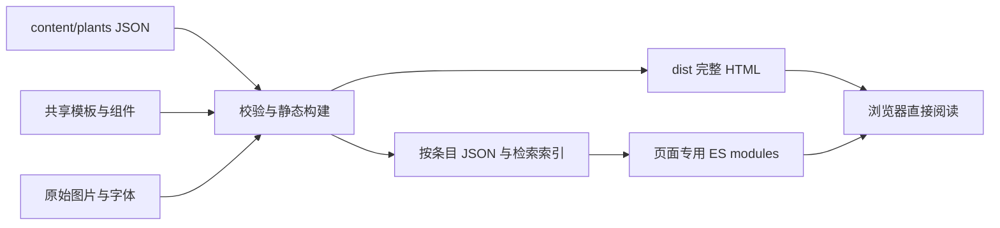

# 技术架构与设计约束

## 产品意图

本项目是可循诗检索的草木文献图鉴。用户既能从熟悉的植物进入古代与现代记载，也能先选篇目寻找相关植物，或按别名、拉丁名、文献关键词交叉检索。资料和图谱应占据阅读主体，导航与交互保持安静。

沿用米白纸色 `#f7f6ef`、草木绿 `#49664d`、楷体标题、细边框和古籍插图。设计变量集中在 `web/styles/tokens.css`；字体使用本地文件和 `font-display: swap`，未加载时仍可阅读。布局在900px和600px断点调整，尊重减少动态效果的系统偏好。

## 数据流

选择静态预渲染，是因为内容以稳定的文献资料为主，没有账户、数据库写入或动态服务需求。生产环境不引入运行时框架；构建工具使用 Node.js，解析历史 HTML 和验证 DOM 使用 LinkeDOM，浏览器验收使用 Playwright。依赖版本由 `package-lock.json` 固定。

## 模块职责

- **内容层**：每个 JSON 记录稳定编号、旧地址、出现篇目、正文段落与图片说明；保存纯文本，渲染时统一转义。编辑器 JSON Schema 和构建校验共同约束内容。
- **共享领域层**：统一 Unicode NFKC、大小写、空白处理和多词 AND 检索；统一编号解析及篇目关系。模板与浏览器复用相同规则。
- **模板层**：统一导航、页脚、植物卡片、正文与图谱，生成语义化标题和完整详情页。详情页和目录阅读区复用同一植物组件。
- **交互层**：各页单独加载模块。目录按需请求一个条目并缓存，取消过期请求；检索只在检索页加载全文索引；篇目筛选直接操作预渲染内容。请求失败保留已读内容。
- **发布层**：只复制明确的网站素材与生成文件至 `dist/`，静态服务器只提供该目录。不会打包 `.git`、本地配置、内容源文件或历史档案。

## 链接与渐进增强

原 `index.html`、`list.html`、`shijing.html`、`search.html`、`head.html` 和所有数字植物文件名继续生成。`list.html#编号` 支持分享和历史导航；普通目录链接始终指向独立详情页，禁用脚本或打开新标签页仍可阅读。检索与篇目筛选同步 `?q=`，支持刷新和分享。

首页不加载任何 JavaScript。目录默认预渲染第一条正文，所有植物与篇目链接均有真实地址。详情页不再嵌套 iframe，也没有重复的滚动容器。点击切换后将焦点移至新条目标题；加载与结果信息通过状态区域通知辅助技术。

## 验证边界

单元测试逐条比对迁移前的正文、标题和图谱数，检查检索语义、无效编号、内容转义与结构约束。DOM测试覆盖网络错误恢复、空结果和过期响应。静态检查验证所有发布页面、锚点、素材和发布目录边界。端到端测试覆盖桌面、手机、禁用脚本、前进后退和真实 HTTP 状态。

原内容保存在 `legacy/` 供审计。正文回归基线需要在有依据的编辑修订时明确更新，不应为了使测试通过而静默重跑迁移或覆盖历史文件。
